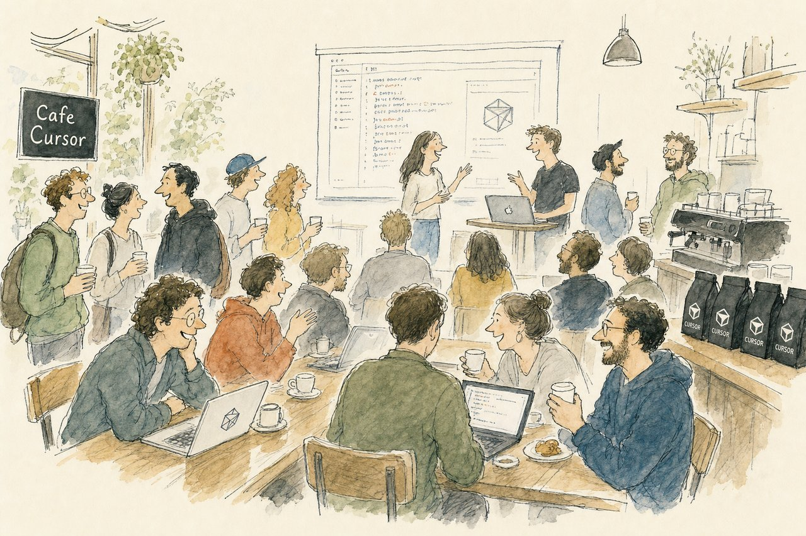

# Cursor Ambassador Evergreen Template



Configurable Next.js template for Cursor Ambassador community sites. Created by [Luis Fernando Romero Calero](https://lfrc.me) ([@luisfer](https://github.com/luisfer)), adapted from [Cursor Thailand](https://cursorthailand.com).

This is a community-maintained template, not an official Cursor product.

## Attribution (required)

Country sites based on this template must show a visible footer credit. The default footer already includes:

> Based on [Cursor Ambassador Evergreen](https://github.com/luisfer/cursor-ambassador-evergreen) by [Luis Romero](https://lfrc.me)

Do not remove that line without replacing it with an equivalent visible credit. Details: [`NOTICE`](NOTICE) and [`ATTRIBUTION.md`](ATTRIBUTION.md).

### What “clamped upstream” means

- The default footer credit stays in the template.
- PRs that strip attribution without an equivalent credit are declined.
- Sample event photography is not redistributed as free stock — hero slots ship as empty placeholders.
- Code remains MIT; deployment credit and media rules live in `NOTICE`.

## Quick Start

```bash
pnpm install
cp .env.example .env.local
pnpm dev
```

Open `http://localhost:3000`.

Before launching a country site, walk through the checklist in [`ATTRIBUTION.md`](ATTRIBUTION.md).

## Project Structure

### App routes

- `app/page.tsx`: homepage on the shared 24-column marketing grid.
- `app/creditos/page.tsx`: Luma email → Cursor credits claim (server-side only).
- `app/recaps/[slug]/page.tsx`: dynamic recap page route.
- `app/slides/[id]/page.tsx`: optional workshop slides route.

### Core components

- `components/ui/`: portable Cursor marketing primitives (`Button`, `Badge`, `TextLink`, card styles). See `docs/ui-kit.md`.
- `components/layout/MarketingGrid.tsx`: 1300px / 24-column page shell with reusable content spans.
- `components/HeroHeaderServer.tsx`: server-side daily photo shuffle into fixed bento slots.
- `components/HeroHeader.tsx`: opaque rounded copy panel over the top-left 2×2 bento slot.
- `components/BentoGrid.tsx`: clean photo grid with click-to-expand.
- `components/CommunityTweets.tsx`: optional curated X/Twitter mosaic (`react-tweet`).
- `components/FeaturedSection.tsx`: featured resource card.
- `components/UpcomingEvents.tsx`: date-grouped event index.
- `components/PastEvents.tsx`: editorial recap index.
- `components/LumaCalendar.tsx`: optional embedded Luma calendar section.
- `components/AmbassadorSection.tsx`: ambassador cards.
- `components/CommunityQuotes.tsx`: optional short quote grid (gated in site config).
- `components/ClosingCTA.tsx`: “Come build with us” band with Turner wallpaper.
- `components/Partners.tsx`: hosting partner cards/logos.
- `components/GlobalEvents.tsx`: world events section wrapper.
- `components/WorldEventsCarousel.tsx`: carousel inside GlobalEvents.

### Content-driven configuration (`content/`)

This template is content-first. Most customization is done by editing files in `content/`.

- `content/site.config.ts`: global site settings (community name, city/country, URLs, locales, footer text, optional sections).
- `content/bento-slots.ts`: fixed hero grid geometry (desktop 4×4, mobile 2×4).
- `content/header-photos.ts`: hero image pool (`src`, `alt` only — images shuffle daily).
- `content/featured.ts`: featured card text + CTA.
- `content/events.ts`: upcoming/past events and recap links.
- `content/ambassadors.ts`: ambassador data and social links.
- `content/partners.ts`: host/sponsor logos and URLs.
- `content/world-events.ts`: world carousel entries.
- `content/community-tweets.ts`: curated tweet status URLs for the optional mosaic.
- `content/community-quotes.ts`: short attendee/ambassador quotes for the optional quotes section.
- `content/recaps/*.ts`: recap documents rendered by slug.
- `content/locales/*.json`: translation dictionaries.
- `content/locales/index.ts`: locale bundle registry consumed by `lib/i18n.tsx`.

## Customization Guide

### 1) Site identity

Edit `content/site.config.ts`:

- `communityName`, `communityNameLocal`, `city`, `country`
- `lumaUrl`, `lumaCalendarEmbedUrl`, `cursorCommunityUrl`
- `defaultLocale`, `locales`
- `footerTagline`
- `description` — short Open Graph / Twitter / `<meta>` description (keep it concrete; avoid marketing fluff)
- `ogImage` — path under `public/` for a 1200×630 share image (template ships `public/og.jpg`; replace with a chapter photo)
- `sections`: toggle optional blocks (`matchmaking`, `photoDisclaimer`, `lumaCalendar`, `communityTweets`, `communityQuotes`)

Set `NEXT_PUBLIC_SITE_URL` in `.env.local` for sitemap, canonical URLs, and Open Graph (`metadataBase`). Without it, previews fall back to `http://localhost:3000`.

### 2) Hero bento grid

Layout slots live in `content/bento-slots.ts`. Images live in `content/header-photos.ts`.

Images shuffle once per day (seeded by date + community name) into fixed slots on the server — no hydration flash. Desktop and mobile use separate shuffles. Layout geometry stays fixed; only photos change.

Add at least as many images as slots (7 on desktop). Run `pnpm validate:bento` after editing slots.

The bento occupies the full hero viewport. An opaque rounded copy panel covers the top-left 2×2 slot (heading + events CTA) — keep that first slot’s geometry in `content/bento-slots.ts`, or update `HeroHeader.tsx` to match. Each photo tile can expand to full-bleed on click (Escape or second click collapses). The daily shuffle remains server-owned.

When pulling upstream into a customized fork, prefer merging `components/` and resolving `content/events.ts` by keeping your events (optionally add `host`). See **Notes for consumers** in `CHANGELOG.md`.

### Automatic themes

Marketing and recap surfaces follow `prefers-color-scheme`: warm off-white in light mode and espresso in dark mode. Semantic `cursor-*` tokens live in `app/globals.css`; components should not add raw page colors.

### 3) Community tweets (optional)

Edit `content/community-tweets.ts` with status URLs from your chapter (`https://x.com/.../status/...`, not profile URLs). Set `relevance` to control order.

**Replace the example seed before enabling.** The template ships global Cafe Cursor / Ben Lang examples. If you set `communityTweets: true` without replacing them, visitors will see those posts — not your chapter's.

Enable the section in `content/site.config.ts`:

```ts
sections: {
  communityTweets: true,
}
```

Tweets are fetched via `react-tweet` and cached at `app/api/tweets/[id]/route.ts` (allowlisted IDs only). The "Browse on X" link uses your `city` and `communityName` from site config. The component is dynamically imported so chapters that leave the toggle off do not ship `react-tweet` in the homepage bundle.

### 4) Events and recaps

Edit `content/events.ts`.

- `status: 'upcoming' | 'past'` controls which list renders the event.
- `displayDate` is shown in the UI (use for TBD labels like "Later this year").
- `date` is optional; when omitted, the event is excluded from homepage JSON-LD.
- `lumaUrl` powers registration links. When missing, a muted "Coming soon" chip appears instead of hiding the CTA.
- `recapPath` connects a past event to a recap route (for example `/recaps/example-event`).
- `thumbnail` is shown in past event cards.

To add a recap:

1. Add a recap file in `content/recaps/` and register it in `content/recaps/index.ts`.
2. Ensure the recap exports a valid recap object with a matching `slug`.
3. Add `recapPath` in the corresponding event.

### 5) Luma integration

- `siteConfig.lumaUrl` — Navbar "Join us", footer "All events", footer CTA fallback
- `event.lumaUrl` — register links on upcoming event cards
- `siteConfig.lumaCalendarEmbedUrl` — embedded calendar (hidden when empty; also set `sections.lumaCalendar: true`)

The curated upcoming list and Luma embed serve different purposes. Avoid duplicating the same events in both without intent.

To enable the calendar embed: copy the embed URL from Luma → Calendar → Embed into `lumaCalendarEmbedUrl`, then set `sections.lumaCalendar: true`.

### 6) Optional slides

Slides are optional and live in `modules/slides/`. See `modules/slides/README.md`.

- Registry: `modules/slides/content/index.ts`
- Skeleton deck: `modules/slides/content/example-deck.tsx` (replace with your content)
- Shareable entry: `/slides` (slide 1). Numbered: `/slides/2`…
- `/slides/1` and invalid `/slides/XX` redirect to `/slides`
- Chrome: `TitleCard`, primitives, `CodeBlock` / `PromptBlock` / `DiagramSlide` (CursorGothic)

If your community does not use slides, remove links to `/slides` from content.

### 7) Ambassadors and partners

- `content/ambassadors.ts`: `name`, optional `role`, `photo`, and links (`x`, `linkedin`, `github`, `website`).
- `content/partners.ts`: partner `name`, `logo`, `url`, optional `logoBg`, optional `logoHeight`.

Local SVG logos in `public/images/partners/` are recommended.

### 8) World events carousel

Edit `content/world-events.ts` entries (`src`, `location`, `date`, `alt`). `GlobalEvents` renders the section; `WorldEventsCarousel` renders the photo grid.

## Locale / i18n

### Current model

- Runtime provider: `lib/i18n.tsx`
- Dictionaries: `content/locales/*.json`
- Bundle registry: `content/locales/index.ts`
- Config gate: `siteConfig.locales`

Language toggle appears when `siteConfig.locales.length > 1`.

### Add a second locale

1. Create `content/locales/xx.json` (for example `th.json`).
2. Register it in `content/locales/index.ts`.
3. Add `'xx'` to `siteConfig.locales`.
4. Optionally set `defaultLocale` to `'xx'`.

## Add or Remove Sections

Homepage order is defined in `app/page.tsx`.

Optional sections are gated in `siteConfig.sections`:

- `matchmaking`: co-working matchmaking card
- `photoDisclaimer`: photo consent notice
- `lumaCalendar`: embedded Luma calendar (also requires `lumaCalendarEmbedUrl`)
- `communityTweets`: curated X/Twitter mosaic (also edit `content/community-tweets.ts`)
- `communityQuotes`: short quote grid (also edit `content/community-quotes.ts`; replace samples before enabling)

The closing CTA (“Come build with us”) and footer always render. Remove an always-on section by deleting its component from `app/page.tsx` — keep the footer template credit.

## Scripts

```bash
pnpm dev                         # local development
pnpm verify                      # format + lint + typecheck + validators + unit tests + build
pnpm validate:bento              # slot overlap / grid coverage check
pnpm validate:community-tweets   # tweet URL/id allowlist + Browse on X href
pnpm test:unit                   # credits CSV / email / assignment tests
pnpm test:e2e                    # Playwright smoke for /creditos (registered, unknown, admin)
pnpm test:credits-api            # optional: claim API against `pnpm start` (run after build)
pnpm test:smoke                  # optional: production server tweet API (needs Twitter egress)
pnpm typecheck                   # TypeScript only
```

## Credits claim (Guadalajara kickoff)

Attendees open `/creditos` (QR at `/creditos/qr`, alias `/claim`) and type the email they used on Luma. The server checks a Luma guests export (`name`, `email`, `approval_status`) and only approved/registered guests receive a credit. Unknown emails see a message to find the organizers at the end of the event.

Three modes, set with `CREDITS_MODE`:

- `pool` (default): unique codes or links, one per email. Re-claiming the same email (trimmed, case-insensitive) returns the same credit. If the pool is empty, they are asked to see the organizers.
- `shared`: every eligible email sees `CREDITS_SHARED_LINK`.
- `dual`: two shared links from env (`CREDITS_LINK_NEW_USERS` for accounts created after 12 Oct 2026, `CREDITS_LINK_EXISTING_USERS` for personal Cursor accounts from before that date). After an eligible email is verified, the page asks which case they are; only then is that one URL returned. Re-claiming shows the question again so they can switch. The URLs are server-only — they are not in the client bundle or in `/creditos` HTML until a successful path choice.

**This repo is public.** Never commit the real Luma CSV, registrant emails, or live credit codes. Sample files under `fixtures/credits/` use `@example.com` only.

### Load guests and credits

Pick one, in this order of convenience:

1. **Admin upload** at `/creditos/admin` (password = `CREDITS_ADMIN_PASSWORD`). Upload the Luma CSV and a `.txt` of codes (one per line).
2. **Gitignored files** on the server:
   - `CREDITS_GUESTS_PATH=.data/luma-guests.csv`
   - `CREDITS_POOL_PATH=.data/credits-pool.txt`
3. **Env vars** for small fixtures or hosted secrets: `CREDITS_GUESTS_CSV`, `CREDITS_POOL` (newline-separated), `CREDITS_SHARED_LINK`.

Claims are stored server-side:

- Node (`pnpm start`, a VPS, Hostinger Node): JSON file at `CREDITS_STORE_PATH` (default `.data/credits-store.json`, gitignored).
- Vercel serverless: set `KV_REST_API_URL` + `KV_REST_API_TOKEN` (Vercel KV) or `UPSTASH_REDIS_REST_URL` + `UPSTASH_REDIS_REST_TOKEN`. Claims then use a Redis lock (one code per email across instances) and a shared rate-limit counter. Without KV, the JSON file is ephemeral between instances.

### Env vars

| Variable                                     | Required                     | Purpose                                                                                                                                  |
| -------------------------------------------- | ---------------------------- | ---------------------------------------------------------------------------------------------------------------------------------------- |
| `NEXT_PUBLIC_SITE_URL`                       | yes in prod                  | Public origin for the QR (no trailing slash)                                                                                             |
| `CREDITS_ADMIN_PASSWORD`                     | yes to claim live            | Organizer password for `/creditos/admin`                                                                                                 |
| `CREDITS_CLAIM_TOKEN`                        | strongly recommended         | On-site secret in the printed QR (`?k=`)                                                                                                 |
| `CREDITS_MODE`                               | no (`pool`)                  | `pool`, `shared`, or `dual`                                                                                                              |
| `CREDITS_SHARED_LINK`                        | if shared                    | Single link shown to every eligible email                                                                                                |
| `CREDITS_LINK_NEW_USERS`                     | if dual                      | Grok referral for accounts created after 12 Oct 2026                                                                                     |
| `CREDITS_LINK_EXISTING_USERS`                | if dual                      | `cursor.com/redeem/event` link for personal accounts from before 12 Oct                                                                  |
| `CREDITS_GUESTS_PATH` / `CREDITS_GUESTS_CSV` | one of these or admin upload | Luma guests export                                                                                                                       |
| `CREDITS_POOL_PATH` / `CREDITS_POOL`         | pool mode, or admin upload   | Unique codes/links, one per line                                                                                                         |
| `CREDITS_STORE_PATH`                         | no                           | Claim log JSON (Node hosts)                                                                                                              |
| `CREDITS_OPEN_AT`                            | no                           | ISO instant; before this, API returns `not_open` (no code, not a failed attempt). Unset = open now. Example: `2026-11-14T10:00:00-06:00` |
| `CREDITS_CLOSE_AT`                           | no                           | ISO instant; at/after this, API returns `closed`. Ignored if not after `OPEN_AT`.                                                        |
| `KV_REST_API_URL` + `KV_REST_API_TOKEN`      | Vercel                       | Persist claims on serverless                                                                                                             |

The claim API is rate-limited (8 attempts / 10 minutes / IP) so the public form cannot be used to enumerate the list quickly. On Vercel the limiter uses `x-vercel-forwarded-for`. On a bare Node host those platform headers are ignored (they are client-controlled) unless you set `CREDITS_TRUST_PROXY=cloudflare` or `nginx`. On Vercel the counter lives in KV; on a single Node process it is in memory. Responses never include other emails or unused codes — only the one credit for a verified address. Admin CSV exports prefix formula-like cells (`=`, `+`, `-`, `@`) so spreadsheet apps will not execute them. Export is POST-only and cookie sessions must come from the same origin.

Set `CREDITS_CLAIM_TOKEN` in production. After logging into `/creditos/admin`, open `/creditos/qr` (login required) and print it. The QR embeds `?k=` so only people at the venue can submit. Without that token, anyone who finds `/creditos` can probe emails against the Luma list (the product still matches on email — Luma has no other attendee id we can use on-site).

### Deploy (do not ship secrets in git)

1. Set `NEXT_PUBLIC_SITE_URL` to the production domain.
2. Set `CREDITS_ADMIN_PASSWORD`.
3. Set `CREDITS_CLAIM_TOKEN` to a long random string and print `/creditos/qr` (it includes `?k=`).
4. Set `CREDITS_MODE` to `pool`, `shared`, or `dual` (and the matching link env vars).
5. Set `CREDITS_OPEN_AT` (and optionally `CREDITS_CLOSE_AT`) if redemption should wait until a clock time. `/creditos` shows a closed state and the API returns `not_open` / `closed` without writing the claim log.
6. On Vercel, add KV (or Upstash) if you need claims to survive. On a Node host, `.data/` on disk is enough.
7. Deploy with the usual Next.js build (`pnpm build` / `pnpm start`, or Vercel defaults).
8. After deploy, open `/creditos/admin`, upload the Luma CSV and the codes (or drop gitignored files on the server).
9. Log into `/creditos/admin` and print `/creditos/qr` for the registration table.

### Export results

From `/creditos/admin` after logging in:

- **Exportar reclamados** → who claimed, when, and which credit
- **Exportar sin reclamar** → eligible Luma guests with no claim yet
- **Exportar intentos fallidos** → emails that were not on the list or were not approved

Use those CSVs at the end of the kickoff to help people who could not claim.

## Changelog

See [`CHANGELOG.md`](CHANGELOG.md) for version history (current: **0.3.1**).

## Image Strategy

This template uses local images in `public/images/` for hero photos, world events, ambassadors, and partner logos.

Hero and world-event slots ship as **empty placeholders** (`public/images/events/placeholder-*.jpg`). Replace them with your own chapter photos before launch (≥7 for the bento). Do not reuse Athita’s photography or other named Cursor Thailand event photos without permission and credit.

The closing CTA uses J. M. W. Turner, _Norham Castle, Sunrise_ (c. 1845) from Wikimedia — public domain; credited in the image `alt` text.

With fully local images, `next.config.js` does not need remote image domains for hero photos. If you enable community tweets, `pbs.twimg.com` and `abs.twimg.com` are already allowlisted for tweet avatars and media.

## Deployment

### Vercel

1. Push to GitHub.
2. Import repository in Vercel.
3. Set `NEXT_PUBLIC_SITE_URL` to your production domain.
4. Deploy with default Next.js settings.

### Other platforms

```bash
pnpm build
pnpm start
```

## Contributing

See `CONTRIBUTING.md`.

## Sites Using This Template

| Country / region     | Site                                                        | Maintainer(s)                                           |
| -------------------- | ----------------------------------------------------------- | ------------------------------------------------------- |
| Austria              | [cursoraustria.com](https://cursoraustria.com)              | —                                                       |
| Belgium              | [cursorbelgium.com](https://cursorbelgium.com)              | [Kris](https://github.com/krismatterz) (`@krismatterz`) |
| Brazil               | [cursorbrasil.com.br](https://cursorbrasil.com.br)          | -                                                       |
| Bulgaria             | [cursorbulgaria.com](https://cursorbulgaria.com)            | [Kristiyan Velkov](https://github.com/kristiyan-velkov) |
| Canada (Calgary)     | [cursorcalgary.com](https://cursorcalgary.com)              | —                                                       |
| Croatia              | [cursorcroatia.com](https://cursorcroatia.com)              | [Nico](https://github.com/nitodeco)                     |
| El Salvador          | [cursorelsalvador.com](https://cursorelsalvador.com)        | —                                                       |
| Germany              | [cursorgermany.com](https://cursorgermany.com)              | [Maurice](https://github.com/mpdesigncode27)            |
| Indonesia            | [cursorindonesia.com](https://cursorindonesia.com)          | —                                                       |
| Italy (Trento)       | [trento.cursor-italy.com](https://trento.cursor-italy.com)  | [Davide Carlomagno](https://github.com/dvdcarlomagno)   |
| Mexico (Guadalajara) | [cursorguadalajara.com](https://www.cursorguadalajara.com/) | -                                                       |
| Netherlands          | [cursornetherlands.com](https://cursornetherlands.com)      | Rogier Muller, Thijs Sondag                             |
| New Zealand          | [cursornewzealand.co.nz/](https://cursornewzealand.co.nz)   | —                                                       |
| Romania              | [cursorromania.com](https://cursorromania.com)              | [Sergei Chyrkov](https://github.com/chyrkov)            |
| Serbia               | [cursorserbia.com](https://cursorserbia.com)                | [Aleksandar Hadzibabic](https://github.com/hadzija7)    |
| South Africa         | [cursorsouthafrica.com](https://cursorsouthafrica.com)      | [@TKala82](https://github.com/TKala82)                  |
| Sri Lanka            | [cursorsrilanka.com](https://cursorsrilanka.com)            | Rasal Jayasinghe                                        |
| Thailand             | [cursorthailand.com](https://cursorthailand.com)            | [Luisfer Romero Calero](https://github.com/luisfer)     |
| UAE                  | [cursoruae.com](https://cursoruae.com)                      | [Juanjo do Olmo](https://github.com/SimplyJuanjo)       |
| USA (Salt Lake City) | [cursorslc.com](https://cursorslc.com)                      | [Will Rowston](https://github.com/wrowston)             |

> This list is forked or deployed from this repo only. Maintainer links point to the GitHub profile that owns or maintains the chapter site when known. Corrections welcome via PR.

Using this template? Open a PR to add your site here.

## Credits

**Created by** [Luis Fernando Romero Calero](https://lfrc.me) ([@luisfer](https://github.com/luisfer)) — design and implementation of this template, adapted from [Cursor Thailand](https://cursorthailand.com) and [Cursor](https://cursor.com) community branding.

**Contributors**

- [Kristiyan Velkov](https://kristiyanvelkov.com/) ([@kristiyan-velkov](https://github.com/kristiyan-velkov))
- [Nico](https://nicomoehn.codes) ([@nitodeco](https://github.com/nitodeco))
- Built with [Cursor](https://cursor.com) and Claude

## License

MIT for code — see [`LICENSE`](LICENSE). Deployment credit and media rules — see [`NOTICE`](NOTICE) and [`ATTRIBUTION.md`](ATTRIBUTION.md).
